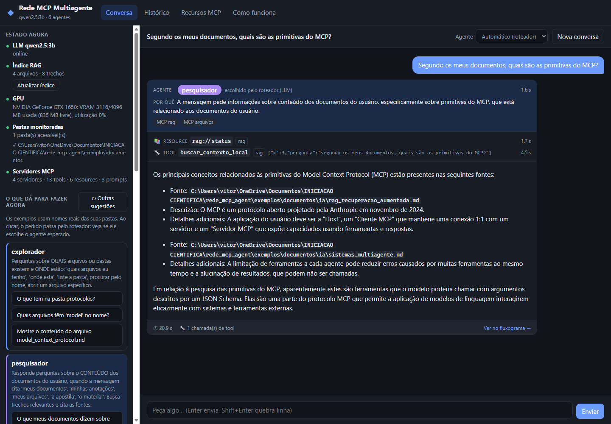
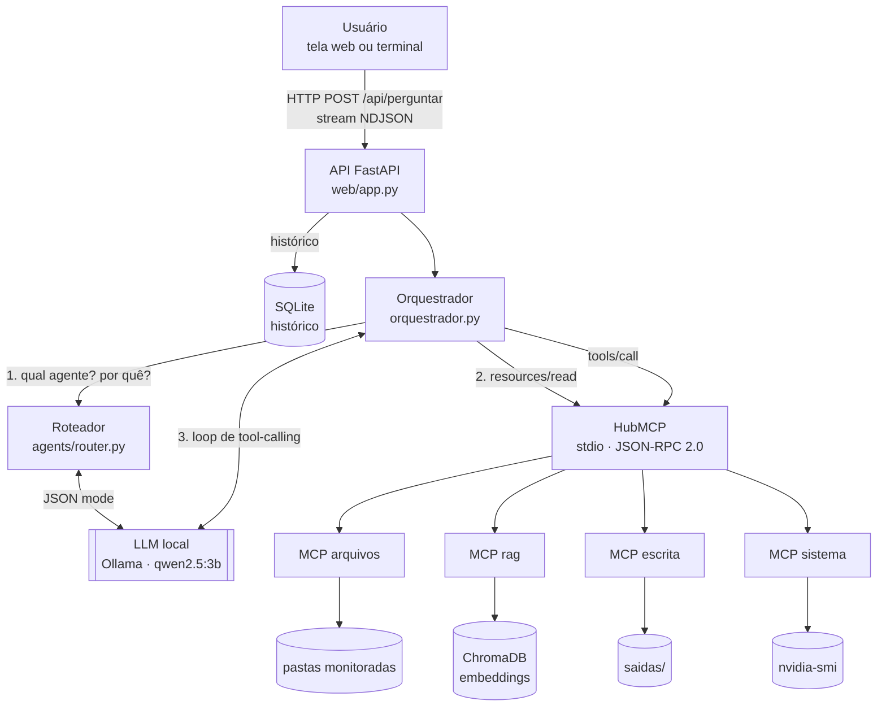
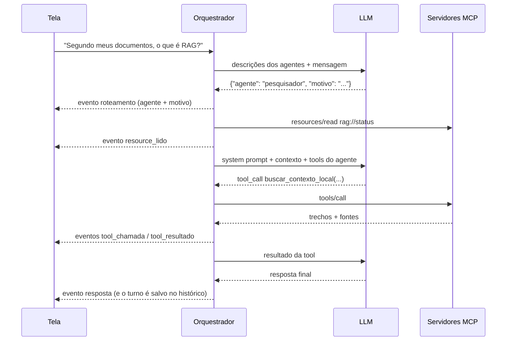
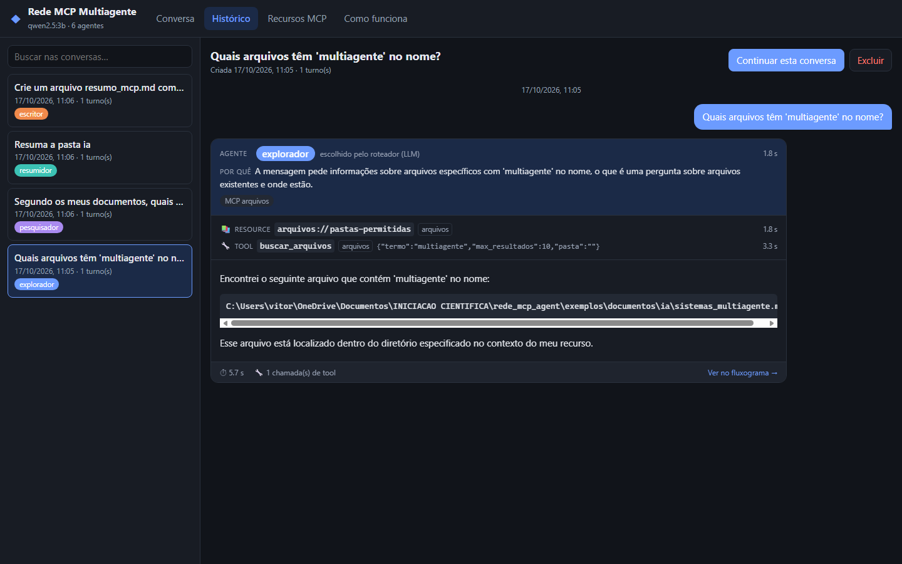
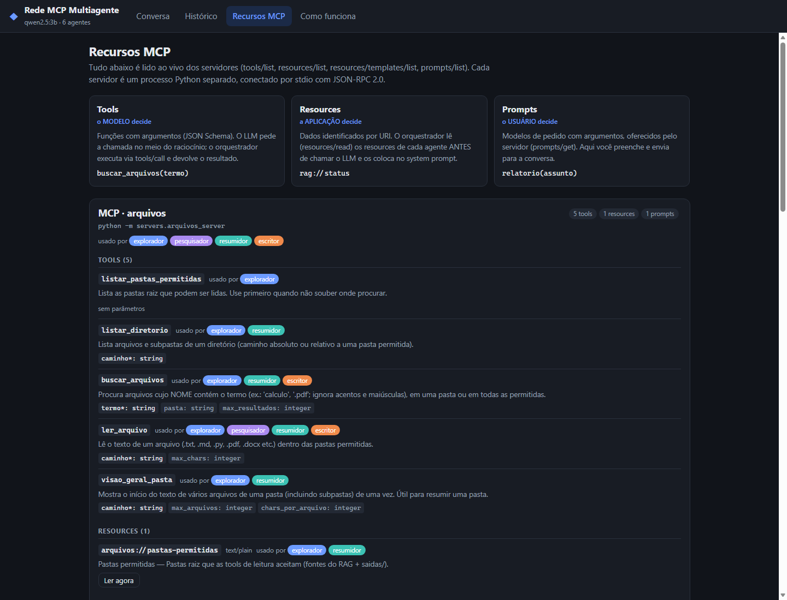
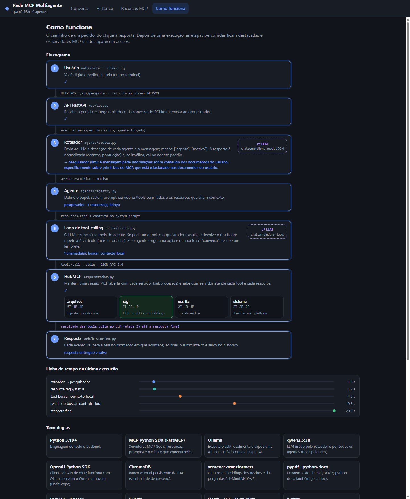

# Rede MCP Multiagente

Sistema multiagente com LLM **local** em que cada pedido do usuário é
encaminhado por um **roteador** (que justifica a escolha) a um **agente
especializado**. O agente executa a tarefa usando **servidores MCP**
(Model Context Protocol) independentes: busca em arquivos locais, RAG
sobre documentos, criação de arquivos e leitura do hardware. Uma interface
web mostra, em tempo real, o agente escolhido, o motivo, cada resource lido,
cada tool chamada e a resposta.

Projeto de Iniciação Científica.



---

## Sumário

- [Objetivo](#objetivo)
- [Arquitetura](#arquitetura)
- [Agentes e servidores MCP](#agentes-e-servidores-mcp)
- [Como executar](#como-executar)
- [A interface](#a-interface)
- [Testes e avaliação](#testes-e-avaliação)
- [Resultados observados](#resultados-observados)
- [Limitações e trabalhos futuros](#limitações-e-trabalhos-futuros)
- [Estrutura do repositório](#estrutura-do-repositório)

Detalhes de projeto e decisões técnicas: [`docs/arquitetura.md`](docs/arquitetura.md).

---

## Objetivo

Investigar como um modelo de linguagem pequeno (3B parâmetros, rodando numa
GPU de 4 GB) pode atuar como sistema multiagente útil sobre os arquivos
pessoais de um estudante, usando o MCP como camada padronizada de acesso a
dados e ações. As perguntas que guiam o projeto são:

1. Um LLM pequeno consegue **rotear** pedidos para o agente certo e explicar o porquê?
2. Restringir as tools por agente torna o uso de ferramentas mais confiável?
3. Quais mecanismos do orquestrador compensam falhas típicas de modelos
   pequenos (descrever a ação em vez de executá-la, laços, alucinação)?

## Arquitetura



Fluxo de um pedido:



Pontos centrais:

- **Um agente é um papel do mesmo LLM**: system prompt próprio, subconjunto
  de tools e resources que viram contexto (`agents/registry.py`).
- **As três primitivas do MCP são usadas**: *tools* (o modelo decide chamar),
  *resources* (a aplicação lê e injeta como contexto antes de chamar o modelo)
  e *prompts* (modelos de pedido que o usuário escolhe na interface).
- **Cada servidor MCP é um processo separado**, conectado por stdio.
- **Tudo vira evento** (`roteamento`, `resource_lido`, `tool_chamada`,
  `tool_resultado`, `aviso`, `resposta`, `erro`), transmitido à tela em tempo
  real e salvo no histórico, o que torna cada execução auditável.

## Agentes e servidores MCP

| Agente | Servidores | Resources de contexto | Faz |
|---|---|---|---|
| `explorador` | arquivos | `arquivos://pastas-permitidas` | localiza arquivos e pastas, abre arquivos |
| `pesquisador` | rag, arquivos | `rag://status` | responde sobre o conteúdo dos documentos, citando fontes |
| `resumidor` | arquivos, rag | `arquivos://pastas-permitidas` | resume arquivo, pasta ou assunto |
| `escritor` | escrita, arquivos, rag | `saidas://lista` | cria arquivos (`.md`, `.txt`, `.docx`, ...) em `saidas/` |
| `sistema` | sistema | `sistema://info` | GPU, VRAM, sistema operacional |
| `geral` | — | — | conhecimento geral, sem tools |

| Servidor | Tools | Resources | Prompts |
|---|---|---|---|
| `arquivos` | `listar_pastas_permitidas`, `listar_diretorio`, `buscar_arquivos`, `ler_arquivo`, `visao_geral_pasta` | `arquivos://pastas-permitidas` | `resumir_pasta` |
| `rag` | `buscar_contexto_local`, `reindexar_documentos`, `status_indice` | `rag://status`, `rag://busca/{pergunta}` (template) | `pergunta_com_fontes` |
| `escrita` | `criar_arquivo`, `listar_arquivos_gerados` | `saidas://lista` | `relatorio` |
| `sistema` | `info_sistema`, `uso_gpu`, `calcular_vram_disponivel` | `sistema://info`, `sistema://gpu` | — |

## Como executar

Requisitos: Python 3.10+, [Ollama](https://ollama.com) e, opcionalmente, uma
GPU NVIDIA.

```bash
git clone <url-do-repositorio>
cd rede_mcp_agent
python -m venv .venv
.venv\Scripts\activate            # Linux/macOS: source .venv/bin/activate
pip install -r requirements.txt

ollama pull qwen2.5:3b            # com o Ollama em execução
```

**Configuração (opcional).** Sem configuração nenhuma, o sistema usa os
documentos de demonstração de [`exemplos/documentos/`](exemplos/documentos).
Para usar suas próprias pastas, copie `.env.example` para `.env` e defina
`MCP_PASTAS`. O `.env` não vai para o git.

**Indexar os documentos** (uma vez; depois é incremental, ou pelo botão na tela):

```bash
python -c "from rag import indexer; print(indexer.build_index())"
```

**Abrir a interface:**

```bash
python -m web.app                 # http://127.0.0.1:8000
```

Ou usar pelo terminal: `python client.py` (`/agente <nome>` fixa um agente,
`/agente auto` volta ao roteador).

> No Windows, não use `uvicorn --reload`: o modo reload troca o event loop
> por um que não suporta subprocessos, e os servidores MCP não sobem.

**Usar outro LLM.** Qualquer endpoint compatível com a API da OpenAI funciona
(`LLM_BASE_URL`, `LLM_API_KEY`, `LLM_MODEL` no `.env`), por exemplo o Qwen na
nuvem via DashScope. Veja `.env.example`.

## A interface

| Aba | O que mostra |
|---|---|
| **Conversa** | Chat com o roteamento ao vivo (agente, motivo, resources, tools, tempos). Ao lado, um **guia do que dá para fazer hoje**: estado real do LLM, do índice, da GPU e das pastas; exemplos de pedido montados com nomes reais das pastas monitoradas; e a lista do que o sistema **ainda não faz**. |
| **Histórico** | Conversas salvas em SQLite, com todos os passos de cada turno, opção de continuar a conversa e **estatísticas por agente** (turnos, tempo médio, erros, uso do fallback). |
| **Recursos MCP** | Catálogo lido ao vivo dos servidores: tools e seus parâmetros, resources (com leitura na hora), templates (com formulário) e prompts (gera o texto e envia para a conversa). Mostra quais agentes usam cada item. |
| **Como funciona** | Fluxograma da arquitetura que **acende as etapas e os servidores usados na última execução**, linha do tempo dos eventos, tecnologias e mapa do código. |

| Histórico | Recursos MCP |
|---|---|
|  |  |



Links diretos: `#historico/<id>`, `#conversa/<id>` e `#fluxo/<id>` abrem uma
conversa específica em cada aba.

## Testes e avaliação

```bash
pip install -r requirements-dev.txt
python -m pytest                          # 44 testes, ~40 s, não precisa do LLM
RODAR_LLM=1 python -m pytest -m llm       # pipeline completo com o Ollama
python -m avaliacao.avaliar_roteador      # acurácia do roteador (precisa do LLM)
```

Os testes cobrem: allowlist de caminhos (inclusive o caso `pasta` vs
`pasta_outra`), parser e fallback do roteador, tools dos servidores (fuga de
diretório, extensões, sobrescrita, `.docx`), indexação incremental e remoção
de arquivos apagados, a lógica do orquestrador com um LLM falso (lembrete do
`exige_tool`, limite de iterações, tool de outro agente), histórico, guia e
uma integração real que sobe os 4 servidores MCP por stdio.

## Resultados observados

Ambiente: `qwen2.5:3b` (Q4_K_M) no Ollama, NVIDIA GTX 1650 4 GB.

**Roteador** ([`avaliacao/`](avaliacao), 25 pedidos rotulados, temperatura 0):

| Versão das descrições dos agentes | Acurácia | Erro principal |
|---|---|---|
| Inicial | 84% (42/50 em 2 rodadas idênticas) | perguntas gerais enviadas ao `pesquisador` (geral: 2/6) |
| Com critérios explícitos ("menciona os documentos do usuário?") | **92%** (23/25) | 1 `explorador` → `pesquisador`, 1 `pesquisador` → `geral` |

As descrições foram ajustadas olhando esse mesmo conjunto, então há risco de
sobreajuste. O próximo passo é avaliar num conjunto separado. Tempo médio
por classificação: ~1,2 s.

**Agentes** (observações qualitativas):

- `explorador`, `sistema` e `pesquisador` chamam a tool certa na maioria dos casos.
- Sem intervenção, o modelo de 3B às vezes **descreve a ação em vez de
  executá-la** (o escritor dizia "vou criar o arquivo..." sem criar). O
  mecanismo `exige_tool` (lembrete automático) resolveu a maior parte desses casos.
- O modelo às vezes envia **argumentos malformados** (ex.: um inteiro como
  objeto). O erro de validação volta para o modelo, que nem sempre se recupera.
- Quando a busca falha, o modelo pode **escrever conteúdo sem base nos
  documentos** (alucinação). O histórico registra o passo que falhou, o que
  permite identificar o problema.

## Limitações e trabalhos futuros

- Modelo pequeno: qualidade das respostas e do uso de tools limitada. Testar
  modelos de 7B+ ou endpoints na nuvem pelo `.env`.
- Embeddings em inglês (`all-MiniLM-L6-v2`): para documentos em português,
  avaliar `paraphrase-multilingual-MiniLM-L12-v2` (`EMBEDDING_MODEL` no `.env`).
- Sem OCR (PDFs escaneados não são lidos) e sem acesso à internet.
- O escritor só cria arquivos novos; não edita nem apaga.
- Avaliação: ampliar o conjunto rotulado, separar validação e teste, e medir
  a taxa de chamadas de tool corretas e a fidelidade às fontes.
- Arquitetura: delegação entre agentes (um agente chamando outro) e
  servidores MCP remotos (HTTP).

## Estrutura do repositório

```
├── config.py               configuração central (lê o .env)
├── orquestrador.py         HubMCP (sessões MCP) + Orquestrador (roteamento, resources, loop de tools)
├── client.py               interface de terminal
├── agents/
│   ├── registry.py         definição dos agentes
│   └── router.py           roteador com motivo (JSON) e comandos /agente
├── servers/
│   ├── arquivos_server.py  MCP: navegação e leitura de arquivos
│   ├── rag_server.py       MCP: busca semântica
│   ├── escrita_server.py   MCP: criação de arquivos em saidas/
│   ├── sistema_server.py   MCP: GPU e sistema
│   └── seguranca.py        allowlist de caminhos
├── rag/
│   ├── indexer.py          chunking, embeddings, ChromaDB, reindexação incremental
│   └── extracao.py         texto de txt/md/py/pdf/docx
├── web/
│   ├── app.py              API REST + stream NDJSON
│   ├── historico.py        persistência SQLite
│   ├── guia.py             guia "o que dá para fazer hoje"
│   └── static/             interface (HTML, CSS, JS sem frameworks)
├── avaliacao/              avaliação do roteador (casos rotulados + resultados)
├── exemplos/documentos/    documentos de demonstração
├── tests/                  testes automatizados (pytest)
└── docs/                   arquitetura e imagens
```

Gerados localmente e fora do git: `.env`, `rag_index/` (índice vetorial),
`dados/` (histórico) e `saidas/` (arquivos criados).
